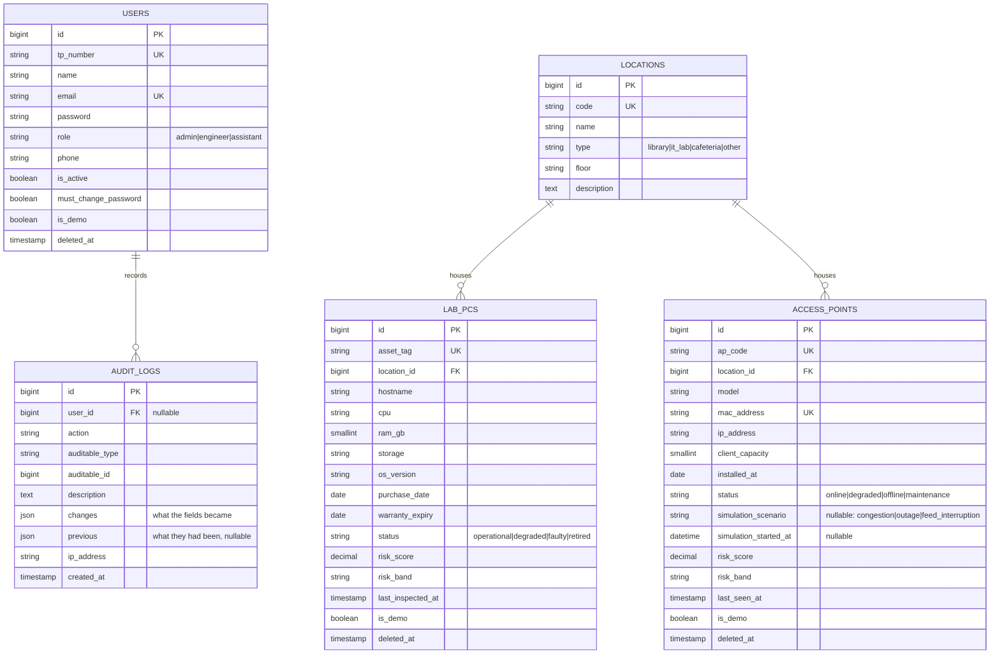
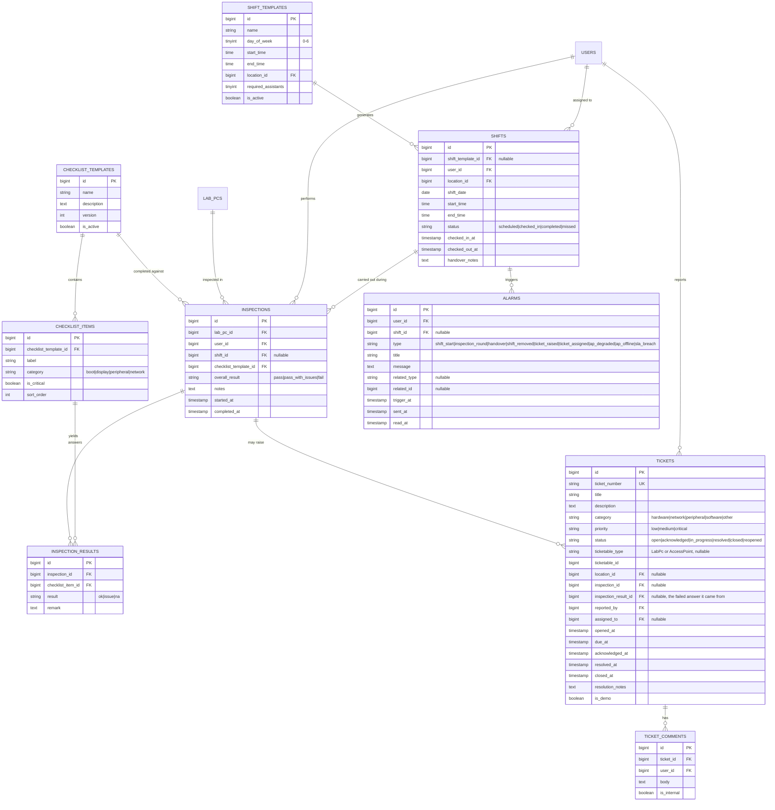
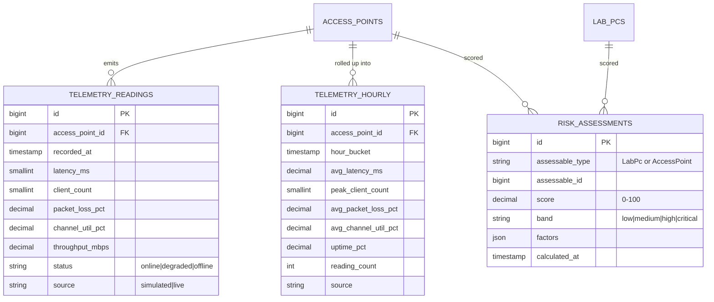

# Database Design

> **Last updated:** 2026-09-23 · **Status:** schema changes need an ADR after the design freeze — see coursework/09-roadmap.md, the freeze date is not yet known
>
> **Rule:** a schema change updates this file in the *same commit* as the migration.

17 domain tables in three clusters, plus Laravel's own infrastructure tables (`sessions`, `password_reset_tokens`, `cache`, `jobs`).

---

## Conventions

Apply these everywhere. They are not negotiable per-module.

| Concern | Convention | Why |
|---|---|---|
| Primary key | `$table->id()` — unsigned `bigint`, auto-increment | Laravel default; every relationship helper assumes it |
| Foreign key | `foreignId('x_id')->constrained()` with an explicit delete rule | Integrity enforced by the database, not application hope |
| Delete rule | `restrictOnDelete()` for reference data (locations, users); `cascadeOnDelete()` for owned children (inspection_results, ticket_comments) | You can never orphan an inspection by deleting a lab |
| Enumerations | MySQL `string` column + PHP backed enum + `$casts` | Adding a status later is a code change, not a risky `ALTER TABLE`. [ADR-0004](decisions/ADR-0004-string-columns-not-mysql-enum.md) |
| Percentages | `decimal(5,2)` | Exact. Never `float` for a number a user reads |
| Money | *(none in this system)* | — |
| Booleans | `is_` or `has_` prefix | Reads as a predicate |
| Timestamps | past-tense verb + `_at` | `resolved_at`, `last_seen_at` |
| Event columns | `dateTime`, never `timestamp` | MariaDB rewrites a `timestamp` column behind your back. See [the trap below](#datetime-not-timestamp) |
| Soft deletes | On `users`, `lab_pcs`, `access_points` | Retiring a machine must not erase its history |
| Timestamps block | `$table->timestamps()` on every table except `telemetry_readings` | Telemetry has its own `recorded_at`; two extra datetimes × millions of rows is waste |

### Required unique keys

`users.email` · `users.tp_number` · `lab_pcs.asset_tag` · `access_points.ap_code` · `access_points.mac_address` · `tickets.ticket_number` · `locations.code`

> Duplicate asset tags are the classic inventory-system demo failure. Enforce it at the database level, not in a validation rule alone.

### Required indexes

| Table | Index | Why |
|---|---|---|
| `telemetry_readings` | `(access_point_id, recorded_at)` | Every chart query. This is the only table that reaches six figures. |
| `telemetry_hourly` | `(access_point_id, hour_bucket)` unique | Prevents duplicate aggregation |
| `tickets` | `(status, priority)` | Queue filtering |
| `tickets` | `(assigned_to)` | "My tickets" |
| `tickets` | `(ticketable_type, ticketable_id)` | Tickets for one asset |
| `inspections` | `(lab_pc_id, completed_at)` | Inspection history, risk scoring input |
| `inspections` | `(user_id, completed_at)` | "What am I part-way through?" — the assistant's resume path |
| `inspection_results` | `(inspection_id, checklist_item_id)` unique | **One answer per item per inspection.** A phone on bad campus Wi-Fi double-submits; without this every answer lands twice and the derived outcome counts the same issue repeatedly. |
| `checklist_items` | `(checklist_template_id, sort_order)` | The inspection form reads exactly this: one template's items, in order |
| `shifts` | `(user_id, shift_date)` | "My shift today" |
| `alarms` | `(user_id, read_at)` | Unread badge count |
| `risk_assessments` | `(assessable_type, assessable_id, calculated_at)` | Risk history chart |

---

## ERD — Cluster A: identity, places, assets



## ERD — Cluster B: daily operations



## ERD — Cluster C: telemetry and analytics



> For the report you need **one consolidated ERD** (Section F item 13). These three clusters are for working comprehension — redraw them as a single diagram in draw.io or Lucidchart before submission.

---

## Table notes

### `tickets` is polymorphic

A ticket can be about a lab PC or an access point. Rather than two ticket tables or two nullable foreign keys, `ticketable_type` + `ticketable_id` handles both.

**Built nullable in M4.** A fault can belong to a place rather than a machine — "no network anywhere on Level 6" is a real ticket that points at nothing more specific than a location. `location_id` is therefore denormalised off the asset rather than joined through the morph, so the engineer's queue can filter by place without reaching into two different asset tables.

The form posts a short key (`lab_pc` / `access_point`), never a class name. Accepting a raw FQCN from a request would let a crafted POST attach a ticket to any model in the system.

### `tickets` lifecycle columns

`status` and every `*_at` in the lifecycle are absent from `Ticket::$fillable`. Only `TicketService` writes them, and it refuses any move the state machine does not allow — see [`../modules/M4-ticketing.md`](modules/M4-ticketing.md)
. `due_at` is stamped once at creation from `config('atlas.sla_hours')`, so changing a target affects new tickets and leaves existing ones on the promise they were given.

```php
// Ticket model
public function ticketable(): MorphTo { return $this->morphTo(); }

// LabPc and AccessPoint models
public function tickets(): MorphMany { return $this->morphMany(Ticket::class, 'ticketable'); }
```

This is the one place a polymorphic relationship genuinely earns its keep — it is easy to explain, and the alternative is worse.

### `dateTime`, not `timestamp`

Every column recording **when something happened** is `dateTime`. This is the single most expensive schema mistake this project has made, and it has been made twice.

MySQL and MariaDB give the first `timestamp` column in a table an implicit `DEFAULT CURRENT_TIMESTAMP ON UPDATE CURRENT_TIMESTAMP` unless `explicit_defaults_for_timestamp` is on, which it is not in XAMPP. The column is then silently reset to the current time by **any** `UPDATE` that does not name it. No error, no warning, and the wrong value looks perfectly plausible.

It cost three columns before anybody noticed:

| Column | What it destroyed |
|---|---|
| `tickets.opened_at` | The SLA baseline `due_at` was computed against. A ticket acknowledged an hour later looked as if it had just been raised. `00:52:02` became `01:04:58` from a status change alone |
| `telemetry_hourly.hour_bucket` | The aggregator upserts, so every re-run rewrote the bucket to `now()`, collapsing distinct hours onto one value and then colliding with the unique index |
| `telemetry_readings.recorded_at` | Nothing yet — inserted only, never updated. The same trap, armed and waiting for the first `UPDATE` anybody wrote |

Those three were converted on 2026-08-29. **Eight more were left**, and it is worth being precise about why they were not causing damage: the implicit auto-update only lands on a **NOT NULL** timestamp column, and all eight happened to be nullable. The protection was an accident of the null flag rather than a property of the design, and it would have disappeared the first time somebody decided one of them should be required. They were converted on 2026-09-08.

Two things follow for anyone adding a column:

- **`created_at` and `updated_at` stay as they are.** Being touched automatically is their entire job.
- **Run `php artisan atlas:check-schema` after any migration.** It reads `information_schema` and fails on any column that has acquired `on update`. The test suite cannot catch this — it runs on SQLite, which has no such behaviour, and that is why the bug survived four weeks of a green suite.

### `risk_assessments` keeps history

A new row per asset per run, rather than overwriting. Costs a few thousand rows and buys the ability to chart an asset's risk trending upward over time — one of the strongest figures available for the report.

The denormalised `risk_score` and `risk_band` columns on `lab_pcs` and `access_points` are a deliberate cache of the latest assessment, so list views do not need a subquery. Update them in the same transaction that writes the assessment.

### `checklist_templates.version`

An inspection stores `checklist_template_id`, so it is permanently tied to the template version it was completed against. Editing an active template creates a new version rather than mutating the existing one — otherwise historical inspections reference items that no longer exist.

**Built in M3.** `ChecklistService` owns the copy-on-write; `is_active` moves to the new version so an edit never leaves the system without a checklist. `is_active` is a plain boolean with a plain index, *not* a unique constraint: "only one active" is a rule the service enforces, because a unique index on the column would forbid a second **inactive** template, which is precisely what versioning produces. MariaDB has no partial unique index to express it properly.

### `inspections.shift_id` has no foreign key yet

The column exists because the ERD has it, but `shifts` is M6's table and does not exist. M6's migration adds the constraint:

```php
$table->foreign('shift_id')->references('id')->on('shifts')->nullOnDelete();
```

Nothing writes the column until then. This is the pattern to follow whenever a module needs a column pointing at a table nobody has built yet — add the column, not the other module's table.

### `telemetry_readings.source`

`simulated` or `live`. Both can sit in the same table. This is what makes the mock/real strategy work without a second database — see [05-data-strategy.md](05-data-strategy.md).

**Built in M5.** `telemetry_readings` is the one table exempt from the `$table->timestamps()` convention: `recorded_at` is the only time that means anything, and two extra datetimes across ~1.7 million rows a month is real cost for nothing.

`status` here is a plain string and must **not** be cast to `ApStatus`. A reading records a MEASURED state — online, degraded or offline only. `ApStatus` is wider because it carries `maintenance`, which is an administrative decision about the access point rather than something anyone measured.

### `access_points.simulation_scenario`

Added 2026-09-19 (`2026_09_19_090001`) for the Network monitor's simulation controls (FR-314). A string cast to `SimulationScenario` — `congestion`, `outage` or `feed_interruption` — and NULL for normal behaviour. `simulation_started_at` is `dateTime`, per the trap below.

**It is not a status.** Only `SimulatedTelemetrySource` reads it, and only for moments at or after `simulation_started_at`, so the backfill never rewrites history as congested. `status` still comes from the classifier. Under a live driver the column is ignored and the controls that set it are refused. Both columns are written only by `SimulationService` with `forceFill()`, never from request input, and every change goes through the audit observer with the user who made it.

### `telemetry_hourly` is unique on `(access_point_id, hour_bucket)`

Not merely indexed. Aggregation is re-runnable by design — scheduled hourly, rebuilding the last three hours, and runnable by hand — and without the unique constraint a second pass over the same hour silently doubles every point on the chart.

Aggregated latency **excludes offline readings**: an unreachable access point has no latency, and counting it as zero makes an outage read as the best hour that AP ever had. Uptime is carried as its own column instead, which is also the figure the report quotes.

### `audit_logs` stores both sides of a change

`changes` is what the fields became, `previous` is what they had been, and the two always describe the same field names.

The observer originally wrote only `changes`, from `getChanges()`. That answers "who changed this" and cannot answer "from what", which is the question an audit trail actually gets asked — "role changed to admin" is not evidence of anything without knowing it had been assistant. `previous` was added on 2026-09-04.

**`previous` is nullable and rows written before that date have none.** There is no honest way to backfill a value nobody recorded, so those rows render as the new value alone rather than claiming a change from nothing.

**Both halves are filtered by the same exclusion list.** Building `previous` from the whole original model instead of from the already-filtered `changes` would write the old password hash into a table administrators can read.

**That list is the model's own `$hidden`, not a list kept in the observer.** It used to be a hand-written `['updated_at', 'remember_token', 'password']`, and it missed `users.calendar_token` — the key that reads somebody's roster feed without signing in. Regenerating a calendar link put a working token into `audit_logs` in plain text. Keying off `$hidden` means the next secret column is covered by the act of declaring it secret. `updated_at` stays excluded separately: it is not a secret, just noise that would make every row look like something happened.

**System-written caches are left out too, through the model's `AUDIT_EXCEPT`.** `access_points.last_seen_at` changes on every collection round, so auditing it wrote one row per access point per minute, about 42,000 a day, and buried every human action on the audit screen. `AccessPoint` excludes `last_seen_at` and `risk_score`; `LabPc` excludes `last_inspected_at` and `risk_score`. Their history is already kept in `telemetry_readings`, `inspections` and `risk_assessments`. A risk band change is still audited, and a save that changes nothing else writes no row. Rows written before 2026-09-23 may hold these heartbeats; they were left in place.

**The collector also saves an access point's `status` quietly** (`saveQuietly()`), because every reading row already records it and at peak an access point near a threshold flaps every few minutes: auditing each flap wrote hundreds of rows an hour, credited to whoever pressed "Generate sample". A status an administrator sets, such as maintenance, goes through a normal save and is audited.

**Shifts are audited** (added 2026-09-23): who was given one, who took it over, check-in and out, missed marking, and removal. A shift row is described by its label, "Thu 24 Sep, 09:00–13:00", and `user_id` is shown as the assistant's name. A moment in a change, such as a check-in, is stored as written (UTC) and shown on the campus clock, using the subject model's casts.

### `is_demo`

On `users`, `lab_pcs`, `access_points`, `tickets`. Set **only** by `DemoDataSeeder`, and read by `php artisan atlas:purge-demo-data`.

Do **not** add a global Eloquent scope that hides demo rows. It will silently hide data during a demo and cost someone an afternoon.

---

## Data dictionary ownership

Section F item 12 requires an **individual** data dictionary per member. Each owner documents the tables their module owns.

| Module | Tables |
|---|---|
| M1 | `users`, `audit_logs` |
| M2 | `locations`, `lab_pcs`, `access_points` |
| M3 | `checklist_templates`, `checklist_items`, `inspections`, `inspection_results` |
| M4 | `tickets`, `ticket_comments` |
| M5 | `telemetry_readings`, `telemetry_hourly` |
| M6 | `shift_templates`, `shifts`, `alarms` |
| M7 | `risk_assessments` |

Data dictionary format for each column: **name · type · size · constraints · description · example value**.
