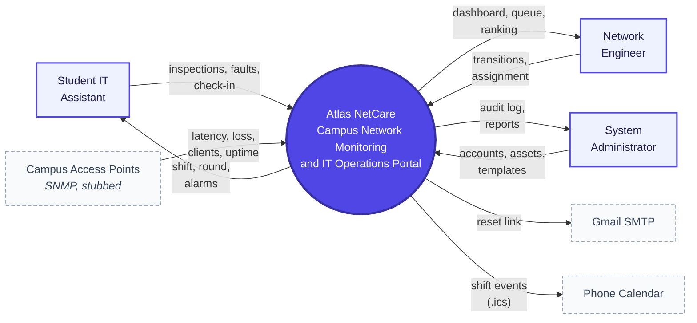
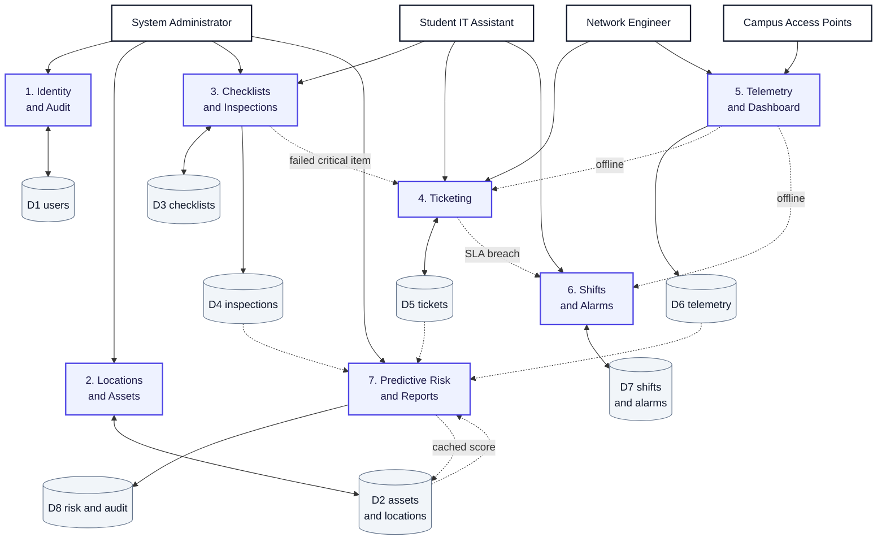

# System Diagrams

> **Last updated:** 2026-09-26
>
> **These four are the whole-system diagrams.** Every one was derived from the code and the live schema on 2026-09-02, not drawn from the proposal — so they describe what Atlas NetCare *is*, not what it was going to be.

---

## How to use these

Every diagram is [Mermaid](https://mermaid.js.org). To get an image:

1. Paste the block into <https://mermaid.live>
2. Export PNG or SVG

GitHub renders Mermaid directly, so they are readable in the repository as well. **Keep the source here.** A diagram that only exists as a PNG cannot be corrected when the code changes.

---

## Figure 1 — Context Diagram

The system as a single process, with everything outside it that gives it data or takes data from it.

Three human roles, and three external systems. The external systems matter as much as the people: two of them are the reason the architecture looks the way it does.

**Two things to be able to say about this diagram.**

The access points are dashed because the connection is real in design and simulated in fact. `TelemetrySource` has two implementations and the live one is a documented stub — see [ADR-0002](decisions/ADR-0002-telemetry-source-driver.md) and [10-simulated-and-real-data.md](10-simulated-and-real-data.md).

The phone calendar is an external system rather than a feature, and that is the point. Rather than build push notifications, the system hands a shift to the phone as an `.ics` file and the phone's own alarm does the reminding — with the app closed and no internet. See [Q5](02-open-questions.md#q5).

---

## Figure 2 — Data Flow Diagram, Level 0

The seven processes inside the system, the eight data stores they read and write, and what moves between them.

**The process numbers are the module numbers.** Process 4 is M4.

**What the arrows between processes are for.** They show the modules connect rather than sitting side by side:

| From | To | What flows |
|---|---|---|
| 3 → 4 | A failed **critical** checklist item pre-fills a ticket, so the assistant does not retype the asset, location and fault |
| 4 → 6 | An **SLA breach** raises an alarm — once per ticket ever, not once per sweep |
| 5 → 4 | An access point going **offline** opens a ticket automatically, on the transition only |
| 5 → 6 | The same transition rings the notification bell for every engineer |
| 7 → D2 | The risk score is **cached back** onto the asset so a list of 200 machines needs no subquery |

Process 7 reads from four stores and writes to two. That is what makes it analytics rather than another screen: it is the only process whose inputs are entirely other processes' outputs.

---

## Figure 3 — Consolidated Entity Relationship Diagram

All sixteen domain tables. Laravel's framework tables — `migrations`, `sessions`, `cache`, `jobs`, `password_reset_tokens` — are deliberately excluded: they are infrastructure, not the domain.

```mermaid
erDiagram
    USERS ||--o{ INSPECTIONS : performs
    USERS ||--o{ TICKETS : reports
    USERS ||--o{ TICKET_COMMENTS : writes
    USERS ||--o{ SHIFTS : works
    USERS ||--o{ ALARMS : receives
    USERS ||--o{ AUDIT_LOGS : acts

    LOCATIONS ||--o{ LAB_PCS : houses
    LOCATIONS ||--o{ ACCESS_POINTS : houses
    LOCATIONS ||--o{ SHIFTS : hosts
    LOCATIONS ||--o{ SHIFT_TEMPLATES : hosts
    LOCATIONS ||--o{ TICKETS : locates

    LAB_PCS ||--o{ INSPECTIONS : undergoes
    CHECKLIST_TEMPLATES ||--o{ CHECKLIST_ITEMS : contains
    CHECKLIST_TEMPLATES ||--o{ INSPECTIONS : governs
    INSPECTIONS ||--o{ INSPECTION_RESULTS : records
    CHECKLIST_ITEMS ||--o{ INSPECTION_RESULTS : answered_by
    INSPECTIONS ||--o| TICKETS : raises

    TICKETS ||--o{ TICKET_COMMENTS : has
    ACCESS_POINTS ||--o{ TELEMETRY_READINGS : emits
    ACCESS_POINTS ||--o{ TELEMETRY_HOURLY : rolls_up_to

    SHIFT_TEMPLATES ||--o{ SHIFTS : generates
    SHIFTS ||--o{ ALARMS : triggers
    SHIFTS ||--o{ INSPECTIONS : contains

    USERS {
        bigint id PK
        string tp_number UK "nullable"
        string name
        string email UK
        string role "admin|engineer|assistant"
        boolean is_active
        boolean must_change_password
        boolean is_demo
        string calendar_token UK "nullable, 48 chars"
        timestamp deleted_at "soft delete"
    }
    LOCATIONS {
        bigint id PK
        string code UK
        string name
        string type "it_lab|library|cafeteria|other"
        string floor
    }
    LAB_PCS {
        bigint id PK
        string asset_tag UK
        bigint location_id FK
        string hostname
        date purchase_date "25% of the risk score"
        date warranty_expiry
        string status "operational|maintenance|faulty|retired"
        decimal risk_score "cached from risk_assessments"
        string risk_band
        datetime last_inspected_at
        boolean is_demo
        timestamp deleted_at "soft delete"
    }
    ACCESS_POINTS {
        bigint id PK
        string ap_code UK
        bigint location_id FK
        string mac_address UK
        string ip_address
        int client_capacity
        string status "online|degraded|offline|maintenance"
        decimal risk_score
        string risk_band
        datetime last_seen_at "drives stale detection"
        boolean is_demo
        timestamp deleted_at "soft delete"
    }
    CHECKLIST_TEMPLATES {
        bigint id PK
        string name
        int version "copy-on-write"
        boolean is_active "only one, enforced in the service"
    }
    CHECKLIST_ITEMS {
        bigint id PK
        bigint checklist_template_id FK
        string label
        string category "boot|display|peripheral|network"
        boolean is_critical "drives the risk factor"
        int sort_order
    }
    INSPECTIONS {
        bigint id PK
        bigint lab_pc_id FK
        bigint user_id FK
        bigint checklist_template_id FK "the VERSION it was done against"
        bigint shift_id FK "nullable"
        string overall_result "pass|pass_with_issues|fail"
        datetime started_at
        datetime completed_at
    }
    INSPECTION_RESULTS {
        bigint id PK
        bigint inspection_id FK
        bigint checklist_item_id FK
        string result "ok|issue|na"
        string remark
    }
    TICKETS {
        bigint id PK
        string ticket_number UK
        string category "hardware|network|software|peripheral|other"
        string priority "critical|medium|low"
        string status "open|acknowledged|in_progress|resolved|closed|reopened"
        string ticketable_type "polymorphic — no FK"
        bigint ticketable_id
        bigint location_id FK
        bigint inspection_id FK "nullable"
        bigint reported_by FK
        bigint assigned_to FK "nullable"
        datetime opened_at "SLA baseline"
        datetime due_at
        datetime resolved_at
        datetime closed_at
        boolean is_demo
        timestamp deleted_at "soft delete"
    }
    TICKET_COMMENTS {
        bigint id PK
        bigint ticket_id FK
        bigint user_id FK
        text body
        boolean is_internal "hidden from the reporter"
    }
    TELEMETRY_READINGS {
        bigint id PK
        bigint access_point_id FK
        datetime recorded_at
        int latency_ms
        int client_count
        decimal packet_loss_pct
        string status "online|degraded|offline"
        string source "simulated|live"
    }
    TELEMETRY_HOURLY {
        bigint id PK
        bigint access_point_id FK
        datetime hour_bucket UK "unique with access_point_id"
        decimal avg_latency_ms
        int peak_client_count
        decimal uptime_pct
        int reading_count
        string source
    }
    SHIFT_TEMPLATES {
        bigint id PK
        string name
        int day_of_week "0 = Sunday, Carbon convention"
        time start_time
        time end_time
        bigint location_id FK
        int required_assistants
        boolean is_active
    }
    SHIFTS {
        bigint id PK
        bigint shift_template_id FK "nullable — times are COPIED"
        bigint user_id FK
        bigint location_id FK
        date shift_date
        time start_time
        time end_time
        string status "scheduled|checked_in|completed|missed"
        datetime checked_in_at
        text handover_notes
    }
    ALARMS {
        bigint id PK
        bigint user_id FK
        bigint shift_id FK "nullable"
        string type
        string related_type "polymorphic"
        bigint related_id
        datetime trigger_at "scheduled ahead of time"
        datetime sent_at "null until dispatched"
        datetime read_at
    }
    RISK_ASSESSMENTS {
        bigint id PK
        string assessable_type "polymorphic"
        bigint assessable_id
        decimal score "0-100"
        string band "low|medium|high|critical"
        json factors "the WHY, stored not recomputed"
        datetime calculated_at "one per run, shared"
    }
    AUDIT_LOGS {
        bigint id PK
        bigint user_id FK "nullable — seeders have no actor"
        string action "created|updated|archived|deleted"
        string auditable_type "polymorphic"
        bigint auditable_id
        json changes "what the fields became"
        json previous "what they had been"
        string ip_address
    }
```

**Four things in this ERD worth knowing.**

**No column is a MySQL `ENUM`.** Every one is a string with a backed PHP enum cast over it — [ADR-0004](decisions/ADR-0004-string-columns-not-mysql-enum.md). Adding a case to a MySQL `ENUM` is a migration and a table lock; adding one to a PHP enum is a line.

**`risk_score` on the two asset tables is a deliberate cache** of the newest `risk_assessments` row. Both are written in one transaction, so the ranking screen and the detail screen cannot disagree.

**Three relationships are polymorphic and therefore have no foreign key**: `tickets.ticketable`, `alarms.related`, `risk_assessments.assessable`. That is a real trade-off, not an oversight — it is why `atlas:purge-demo-data` has to refuse when a genuine ticket points at a demonstration asset, because the database will not stop it.

**Event timestamps are `dateTime`, never `timestamp`.** MariaDB gives the first `timestamp` column in a table an implicit `ON UPDATE CURRENT_TIMESTAMP`, which silently destroyed the SLA baseline on `tickets.opened_at` before it was caught. `created_at` and `updated_at` stay `timestamp`, because being touched automatically is their job.

---

## Figure 4 — System Hierarchy Chart

Every screen, by the role that reaches it. This is the functional decomposition, so it should match the sidebar — and it does, because both are generated from the same route names.

```mermaid
flowchart LR
    ROOT["Atlas NetCare"]

    ROOT --> AUTH["Authentication"]
    ROOT --> ASSIST["Student IT Assistant"]
    ROOT --> ENG["Network Engineer"]
    ROOT --> ADM["System Administrator"]
    ROOT --> SHARED["Shared"]
    ROOT --> AUTOM["Automation (no screen)"]

    AUTH --> A1["Sign in"]
    AUTH --> A2["Forgot password"]
    AUTH --> A3["Reset password"]
    AUTH --> A4["Forced password change"]

    ASSIST --> B1["My Shift<br/><i>check in / out, handover</i>"]
    ASSIST --> B2["Inspections<br/><i>round, checklist form</i>"]
    ASSIST --> B3["My Tickets<br/><i>raise, track</i>"]
    ASSIST --> B4["AP Status<br/><i>read-only</i>"]
    ASSIST --> B5["Network Monitor<br/><i>read-only, no controls</i>"]

    ENG --> C1["Dashboard<br/><i>AP health, polling</i>"]
    ENG --> C2["Access Points<br/><i>list, detail chart</i>"]
    ENG --> C3["Traffic Logs"]
    ENG --> C4["Ticket Queue<br/><i>transition, assign</i>"]
    ENG --> C5["Maintenance Priority<br/><i>ranking, risk detail</i>"]
    ENG --> C6["Network Monitor<br/><i>sample, simulation</i>"]

    ADM --> D0["Network Monitor<br/><i>sample, simulation</i>"]
    ADM --> D1["Users and Roles"]
    ADM --> D2["Locations"]
    ADM --> D3["Lab PCs"]
    ADM --> D4["Access Points"]
    ADM --> D5["Checklist Templates"]
    ADM --> D6["Shift Templates"]
    ADM --> D7["Roster<br/><i>generate, reassign, remove</i>"]
    ADM --> D8["Audit Log"]
    ADM --> D9["Reports"]

    SHARED --> E1["Notifications"]
    SHARED --> E2["Profile"]
    SHARED --> E3["Calendar export"]

    AUTOM --> F1["collect-telemetry<br/><i>every minute</i>"]
    AUTOM --> F2["dispatch-alarms<br/><i>every minute</i>"]
    AUTOM --> F3["aggregate-telemetry<br/><i>hourly</i>"]
    AUTOM --> F4["recalculate-risk<br/><i>daily 02:00</i>"]
    AUTOM --> F5["generate-shifts<br/><i>weekly</i>"]
    AUTOM --> F6["prune-telemetry<br/><i>weekly</i>"]
    AUTOM --> F7["mark-missed-shifts<br/><i>every 5 minutes</i>"]

    classDef root fill:#4f46e5,stroke:#3730a3,color:#fff
    classDef grp fill:#eef2ff,stroke:#4f46e5,color:#1e1b4b
    classDef leaf fill:#f8fafc,stroke:#cbd5e1,color:#334155
    class ROOT root
    class AUTH,ASSIST,ENG,ADM,SHARED,AUTOM grp
    class A1,A2,A3,A4,B1,B2,B3,B4,C1,C2,C3,C4,C5,D1,D2,D3,D4,D5,D6,D7,D8,D9,E1,E2,E3,F1,F2,F3,F4,F5,F6 leaf
```

**Why Automation is on the chart at all.** Six of the system's behaviours have no screen: telemetry collection, alarm dispatch, aggregation, risk scoring, roster generation and retention pruning. A hierarchy chart showing only screens would leave out the half of the system that runs on its own, including the module the project's case-study category depends on.

---

## What Figure 2 leaves out

`AuditObserver` watches seven models across five of the seven modules, so five processes write to `audit_logs` in D8:

| Writes audit rows | Through |
|---|---|
| M1 | `User` |
| M2 | `Location`, `LabPc`, `AccessPoint` |
| M3 | `ChecklistTemplate` |
| M4 | `Ticket` |
| M6 | `ShiftTemplate` |
| *M5 and M7 do not* | no audited model |

Figure 2 draws only `P7 → D8`. Five more arrows into one store would make a Level 0 unreadable. A more detailed diagram of any module in the table should show the write.
